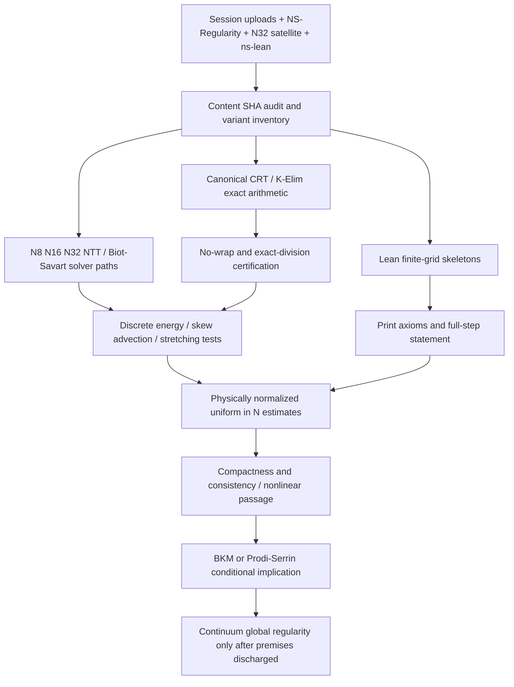

# Build and proof integration DAG

## Promotion gates

| Gate | Concrete pass requirement | Current status |
|---|---|---|
| G0 Provenance | source blob SHA matches, no force overwrites | PASS for imported satellite sources |
| G1 Build | cargo test each independent source crate; lake build each Lean project | requires CI runner; local sandbox lacks toolchains |
| G2 Exact arithmetic | divisors, CRT lane capacity, overflow, centered reconstruction; adversarial tests | existing finite-N evidence, rerun after integration |
| G3 Operator consistency | compare discrete BS / curl / divergence / Laplacian and zero-mode handling | OPEN cross-solver integration |
| G4 Norm physics | correct N/SCALE units for H¹ H² L∞, time step and ν | OPEN across versions |
| G5 Full dynamics | exact-step H² inequality including commutator, stretching, rounding | OPEN general-data bound |
| G6 Uniform estimates | constants independent of N for arbitrary finite-energy smooth data | OPEN |
| G7 Continuum | convergence, pressure, nonlinear passage, regularity criterion premises | OPEN |
| G8 Proof assistant | eliminate load-bearing axioms or isolate exact hypotheses; #print axioms | OPEN full-NS chain |

## Implement in this order

1. Reproduce existing primary `ns_v5` and Lean baselines in their original roots.
2. Run imported `qcid_satellite` independently. Record all output logs, including intentional counterexample tests.
3. Make N32 `ns3d_n32_ntt6.rs` compile as a feature-gated module with its dependent division routines. Verify the N32 output against earlier CRT variants and the primary operator.
4. Port only proved, value-compatible abstractions into primary Rust and Lean roots. Preserve all original snapshots.
5. Discharge named analytic estimates and check Lean axioms; then update the publication claim registry.

**No raw wholesale merge of separate `lib.rs` module roots into the active crate.** Source is preserved and version-addressable; the promotion adapter must be tested.
